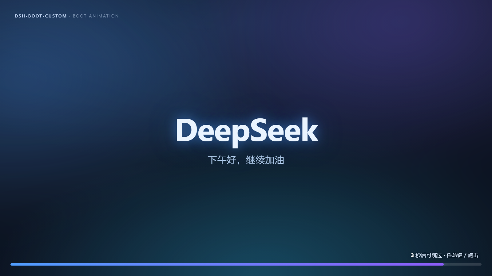
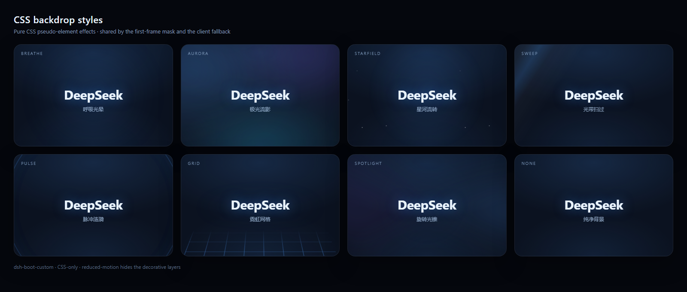

# DSH Boot Custom

为 **DeepSeek Harness（DSH）桌面端**提供可配置的启动动画，支持视频背景、CSS 动效、Logo、问候语、加载进度和音效。

[安装](#安装) · [使用与配置](#使用与配置) · [兼容性与限制](#兼容性与限制) · [开发](#开发) · [故障排查](#故障排查) · [English](#english)



## 主要功能

| 功能 | 说明 |
| --- | --- |
| CSS 背景 | 8 种风格，支持背景色和主题光效颜色 |
| 视频背景 | 最多管理 30 个视频源；每次启动随机选择或按顺序轮换，加载失败时尝试下一条 |
| 启动遮罩 | 通过宿主注入机制在应用挂载前显示遮罩，减少启动阶段的白屏 |
| 展示与跳过 | 可配置启动展示时长、跳过开关、跳过倒计时和 5 种退场转场 |
| 内容与声音 | 可自定义多行 Logo、固定/分时段/随机问候语、进度条、视频原音或独立音效 |
| 全屏预览 | 预览时隐藏设置面板，播放结束后恢复；可随时点击或按 Esc 退出预览 |
| 桌面适配 | 全窗口覆盖、标题栏安全区适配，以及 Windows 原生窗口按钮区域的颜色融合 |
| 无障碍 | 支持减少动态效果偏好、键盘焦点约束、控件标签与状态提示 |

<details>
<summary>查看 8 种 CSS 风格</summary>



</details>

## 安装

### 环境要求

| 项目 | 要求 |
| --- | --- |
| DSH | 包声明的兼容范围为 `>=0.1.7-rc.1 <0.3.0`；当前适配基线为 `0.2.2-rc.1` |
| 安装环境 | 可使用 `dsh` CLI，且已有 `desktop` profile |
| Node.js | 包声明为 `^22.13.0` 或 `>=24.0.0`；源码构建和测试建议使用 Node.js 24 |
| 客户端 | 需要 DSH 的 Web 渲染器与槽位服务；客户端构建目标为 Chromium 120 |

不同平台的验证程度见[兼容性与限制](#兼容性与限制)。

### 安装已有插件包

将命令中的路径替换为实际的 `.tgz` 文件路径：

```powershell
dsh plugin --profile desktop add "D:\path\to\dsh-boot-custom-1.0.4.tgz"
```

安装后，**完全退出并重新启动 DSH 桌面端，包括托盘进程**，再打开「设置 → 开机动画」。宿主配置和启动遮罩在启动阶段加载，仅刷新页面不足以完成安装后的切换。

### 从源码打包

在项目根目录执行：

```bash
npm ci
npm pack
```

`npm pack` 会通过 `prepack` 自动构建，输出 `dsh-boot-custom-<版本号>.tgz`。使用上面的安装命令加载生成的包，文件名以命令实际输出为准。

### 升级与卸载

更新同名插件时，构建或取得新版 `.tgz`，重新执行安装命令并完全重启桌面端。

如果从旧名称 **`dsh-boot-animation`** 迁移，先移除旧插件，避免两套动画同时加载：

```powershell
dsh plugin --profile desktop remove dsh-boot-animation
```

检查目标 profile 的 `dsh.profile.bundles` 和 `cordis.patch.yml` 是否仍有旧插件条目。旧名称的配置不会自动迁移；手动迁移前请备份 profile 配置，具体方式见[完整手册](README.zh.md#4-安装)。

卸载当前插件：

```powershell
dsh plugin --profile desktop remove dsh-boot-custom
```

确认目标 profile 已移除本插件的加载条目，再完全重启桌面端。

## 使用与配置

打开「设置 → 开机动画」调整配置。**常规修改会在短暂延迟后自动保存**，请留意面板中的保存状态和错误提示。

- **预览当前配置**：全屏播放当前设置；预览动作本身不额外保存，但此前的设置修改仍按自动保存规则处理。
- **本地文件的“仅本次预览”**：使用临时文件 URL 播放，媒体地址不会写入配置，重启后不可复用。
- **恢复默认**：重置已保存的配置，回到内置默认值。

### 常用配置

| 字段 | 默认值 | 说明 |
| --- | --- | --- |
| `enabled` | `true` | 启用动画；关闭后不显示启动遮罩和动画 |
| `mode` | `css` | `css` 使用 CSS 背景；`video` 使用视频背景 |
| `cssAnimation` | `breathe` | CSS 风格，也用于视频加载失败后的背景 |
| `bootDuration` | `3` | 配置展示时长，0–18 秒，步长 0.5 秒；具体退场规则见下文 |
| `allowSkip` | `true` | 启动动画是否允许手动跳过 |
| `countdown.enabled` / `countdown.seconds` | `true` / `3` | 启用跳过倒计时，范围 0–10 秒；关闭倒计时或设为 0 可立即解锁跳过 |
| `videos` | `[]` | 视频源列表，最多 30 条 |
| `videoMode` | `random` | `random` 随机选择；`sequence` 在每次启动时选择列表中的下一条 |
| `playing.rate` | `1` | 视频播放速度，0.25–2 倍，步长 0.25 |
| `playing.background` | `#0b1220` | 启动背景色 |
| `logo.text` | `DeepSeek` | Logo 文字，支持多行 |
| `greeting.mode` | `time` | `fixed` 固定文本、`time` 分时段、`random` 随机语录 |
| `progress.realProgress` | `true` | 使用加载里程碑驱动进度提示；关闭后使用时间模拟 |
| `transition.style` | `fade` | `fade`、`slide-up`、`zoom`、`black`、`blur` |
| `transition.duration` | `0.3` | 退场转场时长，0.1–2 秒 |
| `audio.enabled` | `false` | 启用声音，可选择视频原音或自定义音效 |

完整字段和范围见[完整手册的配置项](README.zh.md#5-配置项)。配置类型、默认值和校验分别以 [`types.ts`](src/shared/types.ts)、[`defaults.ts`](src/shared/defaults.ts) 和 [`config.ts`](src/shared/config.ts) 为准。

### 启动时长与跳过规则

- **自动退场**通常同时等待配置展示时长和应用就绪判定。启动遮罩阶段已经耗用的时间会计入配置时长；应用就绪通过 `app/ready` 事件或界面挂载探测判断，探测约 4 秒后有兜底放行。
- **`bootDuration = 0`** 取消自定义时长等待，仍保留客户端动画约 0.9 秒的最短显示保护，以及必要的就绪判定和退场转场；减少动态效果模式另行简化。
- **跳过倒计时**只控制何时允许手动跳过，结束时不会自动关闭动画，也不要求动画一定显示到倒计时结束。
- 启用 `allowSkip` 且倒计时已解锁时，可点击、触摸或按普通按键跳过。Tab 用于焦点切换；F1–F12、单独的修饰键、输入法组合输入等不触发跳过。
- 预览可随时退出，不受启动时的跳过开关和倒计时限制。从宿主记录的启动时间起约 20 秒后会触发超时退场，避免动画长期遮挡界面；退场转场另需少量时间。

### CSS 风格

| 值 | 风格 |
| --- | --- |
| `breathe` | 呼吸光晕（默认） |
| `aurora` | 极光流影 |
| `starfield` | 星河流转 |
| `sweep` | 光带扫过 |
| `pulse` | 脉冲涟漪 |
| `grid` | 霓虹网格 |
| `spotlight` | 旋转光锥 |
| `none` | 纯净背景，保留底色与基础渐变 |

光效颜色跟随 `logo.glowColor`。风格切换只影响背景层，Logo、问候语和进度条等可分别配置。

### 视频、音效与配置保存

- 支持本地路径、`file:///`、HTTP(S) 和相应的媒体 `data:` 地址。文件选择器主要支持 MP4/WebM/MOV 视频和 MP3/WAV/OGG 音频；实际能否播放取决于宿主的编码支持和文件访问策略。
- `sequence` 的轮换游标保存在客户端 `localStorage`，用于下次启动选择；单次启动正常播放结束后不会连续播放整个列表。预览使用列表第一条且不推进游标。
- 单条视频加载失败时依次尝试其他源；全部失败或列表为空时回退 CSS 背景。自动退场由启动规则决定，可能在视频播完前发生。
- 能取得本地绝对路径时优先保存路径；无法取得路径时，可选择仅预览或将较小素材转为 base64。大体积 base64 会增加配置和启动注入负担，超限时会触发注入降级，启动时可能回退 CSS 背景。
- 自定义音效也可在 CSS 模式使用。声音受 Chromium 自动播放策略限制，被拒绝时会静音降级。

配置按宿主能力选择保存方式：`configEditor` → `boot-custom` 设置命名空间 → JSON 文件。只有最后一种降级模式使用 `<profile>/boot-custom/config.json`，并非所有安装都会生成该文件。

## 兼容性与限制

- **DSH 0.2.2-rc.1**：仓库的[兼容性矩阵](docs/compat-matrix.md)记录了真实临时 Web profile 的加载、保存/重置和预览验证；桌面窗口的完整启动验收仍待补充。
- **启动遮罩的时机**：Web 宿主把遮罩放入索引 HTML；0.2.2 桌面端通过 IPC 在 React 挂载前应用注入行。桌面静态文档的第一帧仍由宿主控制。
- **旧宿主**：保留 0.1.7 系列的设置和文件存储降级路径；兼容范围声明与每个版本的实际验证结果需分别看待。
- **平台与显示**：Windows 原生窗口按钮的融合效果需要在桌面环境确认；macOS、Linux、DPI 和缩放的具体覆盖程度见兼容性矩阵。
- **进度条**：根据文档、界面槽位、字体等加载里程碑平滑映射，作为加载提示使用，不能代表全部宿主任务的精确完成比例。
- **减少动态效果**：系统启用 `prefers-reduced-motion: reduce` 时跳过视频和入场动效，隐藏背景装饰，并缩短退场。
- **媒体路径**：拒绝 UNC 路径和带远程主机名的 `file://` 地址；本地文件还受宿主访问策略限制。

## 开发

项目使用 TypeScript，宿主和客户端分别构建；React 由 DSH 壳层提供。

```bash
npm ci
npm run typecheck
npm test
```

| 命令 | 用途 |
| --- | --- |
| `npm run build` | 构建全部宿主和客户端产物到 `lib/` |
| `npm run build:host` | 仅构建宿主 |
| `npm run build:client` | 仅构建客户端，保留宿主产物 |
| `npm run typecheck` | 检查宿主与客户端类型 |
| `npm test` | 自动构建后运行 `node:test`，包含 jsdom、配置、路由和无障碍测试 |
| `npm run test:coverage` | 自动构建后运行覆盖率检查，门槛为行 85%、分支 60%、函数 60% |
| `npm run test:e2e` | 运行 Playwright 浏览器测试，需要事先构建并准备浏览器 |
| `npm pack` | 自动构建并生成可安装的 `.tgz` 包 |

运行浏览器测试：

```bash
npm run build
# 非 Windows 环境或 CI 首次运行时准备 Chromium
npx playwright install chromium
npm run test:e2e
```

本地 Windows 默认使用已安装的 Microsoft Edge，可省略 Chromium 安装步骤；其他环境默认使用 Playwright Chromium，也可通过 `PLAYWRIGHT_CHANNEL` 指定浏览器渠道。详见 [`playwright.config.ts`](playwright.config.ts)。

### 项目结构

```text
src/
├─ index.ts                # 宿主入口、配置、启动注入与路由注册
├─ host/                   # 配置 schema、存储、HTTP 路由、启动遮罩
├─ client/
│  ├─ index.ts             # DSH 客户端入口
│  ├─ overlay.ts           # 动画槽位与预览
│  ├─ boot/                # 动画控制、媒体、时序、进度与倒计时
│  ├─ runtime/             # 资源释放、环境、标题栏与预览呈现
│  └─ settings/            # 设置面板、控件、文件导入与客户端存储
└─ shared/                 # 类型、默认值、校验与 CSS 风格
scripts/build.mjs          # 宿主 tsc + 客户端 esbuild 和模块加载器包装
tests/                     # Node.js 测试与 Playwright 浏览器测试
lib/                       # 随包发布并纳入版本管理的构建产物
docs/                      # 预览图片与兼容性矩阵
```

修改 `src/` 后重新构建，避免直接编辑 `lib/`。宿主输出 ESM；客户端输出由 `window.__ModuleLoader__` 加载的脚本。CI 会检查类型、测试、覆盖率，以及已提交的 `lib/` 能否由源码重建；浏览器测试使用模拟壳层，完整桌面流程仍需人工验收。

## 故障排查

| 现象 | 检查方式 |
| --- | --- |
| 找不到 `dsh` 命令 | 确认 DSH CLI 可用，并在其可用的终端环境执行安装 |
| 插件未加载或没有“开机动画”设置页 | 确认安装到了正确 profile、已完全重启；检查 `dsh.profile.bundles`、渲染器和设置服务是否加载，以及 `[dsh-boot-custom]` 日志 |
| 仍然出现启动白屏 | 核对宿主是否支持启动注入；区分 Web HTML 注入与桌面 IPC 注入时机，见兼容性说明 |
| 设置面板显示异常或预览后未恢复 | 检查是否同时加载旧名称插件；完全退出并重启，再查看客户端日志 |
| 视频黑屏或转为 CSS 背景 | 检查路径、网络、媒体编码与本地文件权限；用较小的已知可播放文件验证 |
| 没有声音 | 确认已启用音效、音量和来源正确；检查自动播放策略是否导致静音降级 |
| 保存失败或重启后配置丢失 | 查看面板保存状态；确认未使用“仅本次预览”；宿主重启后刷新页面以更新会话信息，再检查存储与路由错误 |
| 希望更快进入应用 | 调低 `bootDuration`；如需手动立即跳过，启用 `allowSkip` 并关闭倒计时或设为 0；仍需等待宿主完成必要加载 |

更多配置和运行时细节见 [README.zh.md](README.zh.md)，版本变化见 [CHANGELOG.md](CHANGELOG.md)。

## English

**DSH Boot Custom** adds configurable boot animations to the DeepSeek Harness desktop app: eight CSS backgrounds, video selection across launches, a startup mask, custom logo and greetings, progress hints, audio and full-window previews.

Build an installable archive with `npm ci` and `npm pack`, then install the resulting `.tgz` using `dsh plugin --profile desktop add "path/to/package.tgz"`. Fully restart the desktop app and open **Settings → 开机动画**. Settings changes save automatically; previewing a temporary local file does not persist that file URL.

The package declares DSH `>=0.1.7-rc.1 <0.3.0` compatibility. See the [compatibility matrix](docs/compat-matrix.md) for tested environments and remaining desktop validation.

## 许可证

[MIT](LICENSE)
