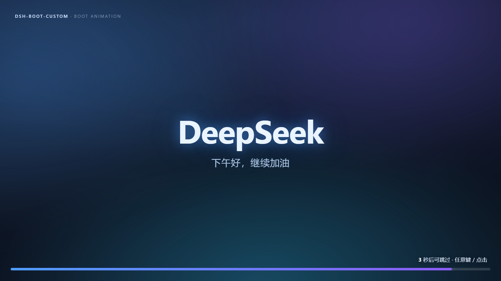
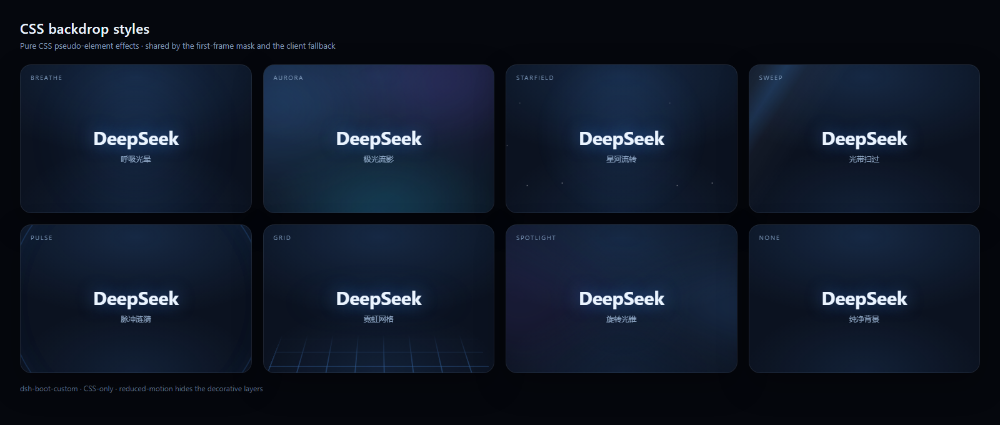

<div align="center">
  
  <h1>DSH Boot Custom</h1>
  <p>给 DeepSeek Harness 桌面端一个完整的开机动画：视频轮播、8 种 CSS 风格、首帧防白屏、任意键跳过，以及可配置的进入时机。</p>
  <p>
    
    
    
    
  </p>
  <p>
    <a href="#快速开始">快速开始</a> ·
    <a href="#配置">配置</a> ·
    <a href="#css-动画风格">CSS 风格</a> ·
    <a href="#性能">性能</a> ·
    <a href="README.zh.md">完整手册</a> ·
    <a href="CHANGELOG.md">更新日志</a> ·
    <a href="#english">English</a>
  </p>
</div>

> 上图为插件实际 CSS 背景动画的渲染预览，展示「极光流影」风格。

## 功能

- **视频轮播**：最多 30 个视频源，支持本地文件、`file:///`、HTTP(S)、`data:`；随机单次或顺序循环；单条失败自动切换下一条。
- **8 种 CSS 背景动画**：呼吸光晕、极光流影、星河流转、光带扫过、脉冲涟漪、霓虹网格、旋转光锥、纯净背景；纯 CSS 伪元素实现，无额外 DOM 与 JS 计时器。
- **首帧防白屏**：宿主通过 `webserver/index-inject` 注入首帧遮罩，浏览器绘制第一帧就是动画背景；12 秒未认领自保。
- **进入时机**：动画至少播放 `bootDuration` 秒，并且应用已就绪，才显示软件页面；不会出现应用页面提前顶掉动画。
- **任意键 / 点击跳过**：支持鼠标、触摸和任意键盘按键；仍遵守「允许跳过」与「跳过倒计时」。
- **完整可配置**：Logo、问候语、真实进度条、跳过倒计时、5 种退场转场、自定义音效、播放速度。
- **桌面融合**：全窗口固定定位，覆盖侧边栏与标题栏；Windows 原生 caption 按钮区域透明，图标颜色随背景自适应。
- **设置内预览**：预览时自动隐藏设置面板并全屏播放，结束后恢复；当前草稿不会写入配置。
- **性能友好**：客户端 bundle 已压缩，CSS 装饰层在视频正常播放时暂停，首帧只注入当前风格的 keyframes。

## 界面预览

<details>
<summary>展开 8 种 CSS 风格预览</summary>
<br />

</details>

## 快速开始

### 环境要求

| 项目 | 要求 |
| --- | --- |
| DSH Desktop | `0.1.7+`（推荐 `0.2.x`） |
| Node.js（仅从源码构建时需要） | `^22.19.0` 或 `>=24.0.0` |
| 平台 | Windows / macOS / Linux（Windows 原生标题栏融合最完整） |

### 安装

1. 从 Releases 下载 `dsh-boot-custom-1.0.0.tgz`，或在本仓库执行 `npm pack` 生成。
2. 安装到 desktop profile：

```powershell
dsh plugin --profile desktop add "path\to\dsh-boot-custom-1.0.0.tgz"
```

3. **完全退出并重启**桌面端（包括托盘进程），不要只刷新页面。
4. 打开「设置 → 开机动画」。

### 从源码构建

```bash
npm install
npm run typecheck
npm run build
npm test          # 49 项测试
npm pack          # 生成 dsh-boot-custom-1.0.0.tgz
```

### 升级

升级前请先卸载旧包并清理 profile：

```powershell
dsh plugin --profile desktop remove dsh-boot-animation
```

同时从 profile 的 `cordis.patch.yml` 删除旧的 `dsh-boot-animation` 行，并从 `dsh.profile.bundles` 移除旧包。旧配置不会自动迁移；可在新设置页重新配置，或把旧行的 `config` 复制到新行。

### 卸载

```powershell
dsh plugin --profile desktop remove dsh-boot-custom
```

## 配置

所有配置都在「设置 → 开机动画」中，修改后自动保存。完整字段、范围和运行时说明见 [README.zh.md §5](README.zh.md#5-配置项)。

| 字段 | 默认 | 说明 |
| --- | --- | --- |
| `enabled` | `true` | 总开关；关闭后不注入首帧遮罩 |
| `mode` | `css` | `css` 纯 CSS 动画；`video` 视频轮播 |
| `cssAnimation` | `breathe` | 8 种 CSS 风格之一 |
| `bootDuration` | `3` | 最少展示秒数（0–18，步长 0.5）；应用未就绪时继续等待 |
| `allowSkip` | `true` | 关闭后点击 / 任意键均无效 |
| `countdown.seconds` | `3` | 跳过倒计时；0 表示立即可跳过 |
| `videos` | `[]` | 视频源列表，最多 30 条 |
| `videoMode` | `random` | `random` 随机单次；`sequence` 顺序循环 |
| `playing.rate` | `1` | 0.25x–2x，步长 0.25 |
| `logo.text` | `DeepSeek` | 多行 Logo 文本 |
| `greeting.mode` | `time` | 固定 / 分时段 / 随机语录 |
| `progress` | 胶囊 / 底部 / 真实进度 | 进度条样式与位置 |
| `transition.style` | `fade` | fade / slide-up / zoom / black / blur |
| `audio.enabled` | `false` | 视频原音或自定义音效 |

### 启动时长与跳过

- `bootDuration = 3`：从首帧绘制开始计时，动画至少 3 秒，同时应用已就绪才进入；应用加载慢时动画保持。
- `bootDuration = 0`：不额外等待，应用就绪即退场（最快启动）。
- 倒计时结束前点击/按键不生效；结束后任意键或点击立即跳过。
- 完全关闭跳过：`allowSkip = false`。

## CSS 动画风格

| 值 | 名称 | 特点 |
| --- | --- | --- |
| `breathe` | 呼吸光晕 | 中央柔光缓慢呼吸，默认、最克制 |
| `aurora` | 极光流影 | 蓝 / 紫 / 青三色光斑漂移 |
| `starfield` | 星河流转 | 星点缓慢漂移并闪烁 |
| `sweep` | 光带扫过 | 斜向高光周期掠过 |
| `pulse` | 脉冲涟漪 | 双圈光环从中心扩散 |
| `grid` | 霓虹网格 | 底部透视网格向前流动 |
| `spotlight` | 旋转光锥 | 大面积光锥缓慢旋转 |
| `none` | 纯净背景 | 只保留底色与基础渐变 |

颜色自动跟随 `logo.glowColor`；所有风格只作用于背景层，不影响 Logo、问候语、进度条和倒计时的布局。

## 性能

1.0.0 针对启动路径做了以下优化：

- **客户端 bundle 压缩**：`lib/client.js` 从约 178 KB 降至约 99 KB（约 -45%），减少启动时的下载、解析与执行时间。
- **默认动画时长 5s → 3s**：启动等待更短；仍可在设置中调到 0–18 秒。
- **启动时长从首帧计时**：首帧遮罩的展示时间计入 `bootDuration`，不会在客户端挂载后再额外叠加一整段等待。
- **首帧注入按需输出**：只注入当前选中 CSS 风格的 keyframes，而不是全部 8 种。
- **视频模式暂停装饰层**：视频正常播放时，fallback 的 CSS 动画通过 `animation-play-state: paused` 暂停，避免后台空转。
- **配置读取不阻塞**：0.2.x config-editor 路径不读取额外文件；首帧与客户端共享同一份规范化配置。
- **无额外 DOM**：CSS 动画全部由伪元素实现，不创建粒子节点或动画容器。

如果仍希望更快进入：把「启动动画时长」设为 `0`，或选择 `none` 风格以降低 GPU 负担。

## 兼容性

| 运行时 | 行为 |
| --- | --- |
| DSH 0.2.x（推荐） | `configEditor.edit(entry, change)`、`settings.section`、`webserver/index-inject`、`shell.overlay` |
| DSH 0.1.7+ | Volatile Config、config editor、`loader/volatile-update` |
| 0.1.x 无 configEditor | `ctx.settings` 命名空间，最后回退 JSON 文件 |
| 无设置插件 | 动画仍可启动；设置页等待 `settings.section` |
| `prefers-reduced-motion` | 跳过视频/入场动画，隐藏装饰层，保留纯色遮罩 |

## 项目结构

```text
src/
├─ index.ts                 # 宿主入口：Config、首帧注入、路由、存储
├─ host/                    # schema / store / routes / first-frame
├─ client/
│  ├─ index.ts              # 客户端入口：inject = ['slots'] + apply
│  ├─ overlay.ts            # shell.overlay 槽位与预览
│  ├─ boot/                 # controller / video / audio / progress / countdown / styles
│  ├─ runtime/              # ledger / env / titlebar / preview-presentation
│  └─ settings/             # 设置面板、控件、文件处理、客户端存储
└─ shared/                  # 类型、默认值、校验、CSS 动画风格、问候/轮播
scripts/build.mjs           # tsc(host) + esbuild(minified client) + loader 包装
tests/                      # node:test + jsdom
docs/                       # README 图片
```

## 开发

```bash
npm install
npm run typecheck
npm run build
npm test
```

- 宿主：TypeScript → ESM（`lib/index.js`）。
- 客户端：esbuild → CommonJS → `window.__ModuleLoader__.load(...)` 包装（`lib/client.js`）。
- React 由 shell 提供，不打进 bundle。
- 修改 `src/` 后必须重新 `npm run build`；`lib/` 是生成产物。

## 故障排查

| 现象 | 排查 |
| --- | --- |
| 设置页没有「开机动画」 | 设置壳是否加载；`settings.section` 是否声明；控制台是否有 `[dsh-boot-custom]` 报错 |
| 设置面板空白 / 看不到 × | 插件已固定设置壳外层滚动并在操作区提供「关闭设置」；检查 profile 是否残留旧 `dsh-boot-animation` 行，完全退出后重启 |
| 启动仍然很慢 | 调整「启动动画时长」；检查是否启用了高 GPU 负担风格；确认已重启加载新 bundle |
| 视频黑屏 | 编码/容器支持；`file://` 策略；尝试 HTTP 源或 base64 |
| 没有声音 | Chromium 自动播放策略；插件会自动静音降级 |
| 保存失败 | 面板会显示错误；检查 config-editor entry / settings 命名空间 / 路由状态 |
| 配置重启后丢失 | 是否用了「仅本次预览」；base64 是否超限；bundle 是否仍在 profile 中 |

更多运行时契约和逐项配置见 [README.zh.md](README.zh.md)。

## 贡献

欢迎提交 Issue 和 Pull Request。提交前请运行：

```bash
npm run typecheck && npm test
```

## License

[MIT](LICENSE) © dsh-boot-custom contributors

---

## English

**DSH Boot Custom** is a boot-animation plugin for the DeepSeek Harness desktop app.

- Video rotation (local files, HTTP, data URIs) or 8 pure-CSS backdrop styles.
- First-frame anti-flash mask injected through `webserver/index-inject`.
- Configurable minimum boot duration (`bootDuration`, default 3 s), with the app page revealed only after both the animation and app-ready gates pass.
- Any key or pointer click skips once `allowSkip` and the countdown allow it.
- Logo, greeting, real progress, countdown, five exit transitions, custom audio.
- Full-window fixed overlay, Windows caption-strip fusion, in-settings preview.
- 49 tests, MIT licensed.

**Install**

```bash
dsh plugin --profile desktop add "path/to/dsh-boot-custom-1.0.0.tgz"
```

Fully restart the desktop app, then open **Settings → 开机动画**. The complete configuration manual is in [README.zh.md](README.zh.md).
